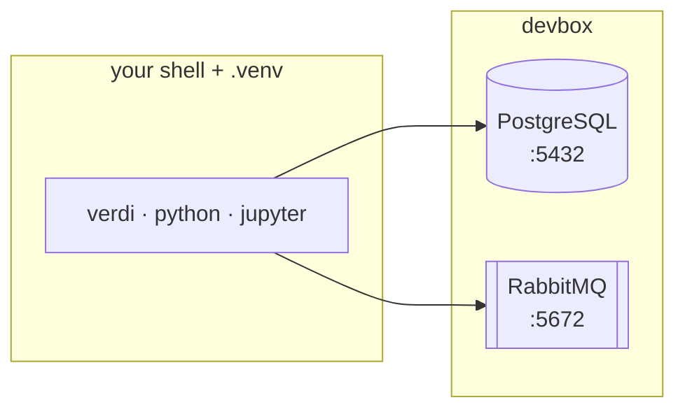

# devbox-aiida

A ready-to-use environment for [AiiDA](https://www.aiida.net/): **PostgreSQL** and **RabbitMQ** run as background services managed by [devbox](https://www.jetify.com/devbox), with no system-wide installation. Scripts create the Python environment and the AiiDA profile, and register computers and codes from YAML files.

!!! info "Do not run `devbox shell`"
    Use devbox for the services and for `devbox run ...` scripts. For everything else, activate the virtual environment in your own shell with `source scripts/init_hook.sh`. Entering `devbox shell` replaces your shell and you lose features such as `verdi` tab completion.



## Quick start

```bash
devbox install                     # install PostgreSQL, RabbitMQ, Python
devbox run install-requirements    # create .venv, initialise PostgreSQL, install aiida-core
devbox services up -b              # start PostgreSQL and RabbitMQ
source scripts/init_hook.sh        # activate .venv and set AIIDA_PATH (every new terminal)
devbox run create-aiida-profile    # first time only: create a profile
verdi status
```

!!! tip "One-word shortcut"
    Add `alias gtd='cd /path/to/devbox_aiida && source scripts/init_hook.sh'` to your `~/.bashrc` to jump to the folder and load the environment.

## Choose a path

<div class="grid cards" markdown>

-   :material-rocket-launch: **Install**

    Step-by-step first-time setup, from an empty checkout to a working profile.

    [:octicons-arrow-right-24: Installation](installation.md)

-   :material-server: **Run the services**

    Start, stop, inspect and debug PostgreSQL and RabbitMQ.

    [:octicons-arrow-right-24: Manage the services](how-to/services.md)

-   :material-lan-connect: **Add computers and codes**

    Register local and remote resources from YAML files, with duplicate detection.

    [:octicons-arrow-right-24: Computers and codes](how-to/computers-and-codes.md)

-   :material-sitemap: **Understand the layout**

    What devbox provides, what lives in the virtual environment, and where the data is stored.

    [:octicons-arrow-right-24: Architecture](concepts/architecture.md)

</div>
